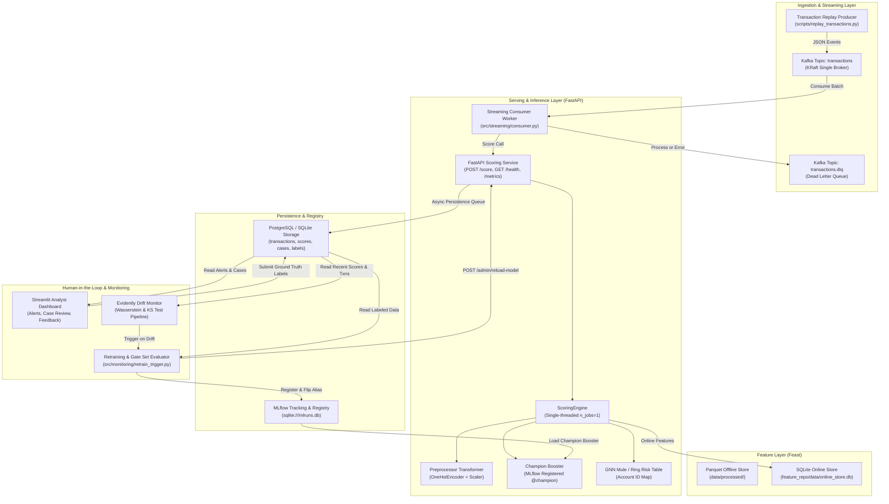
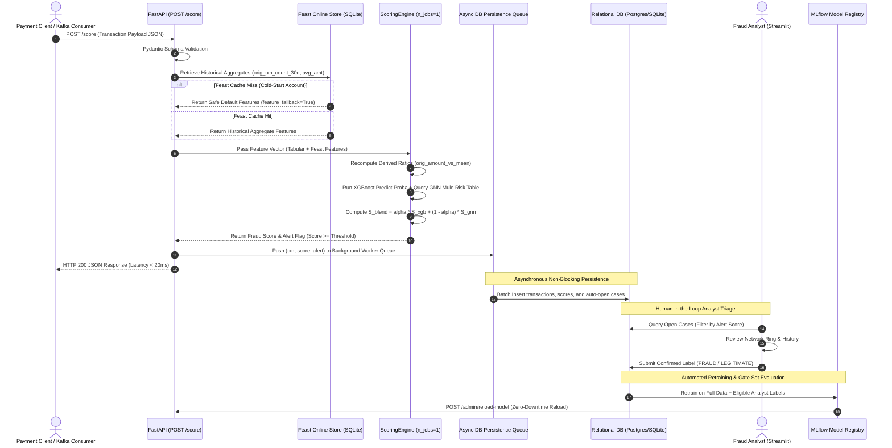
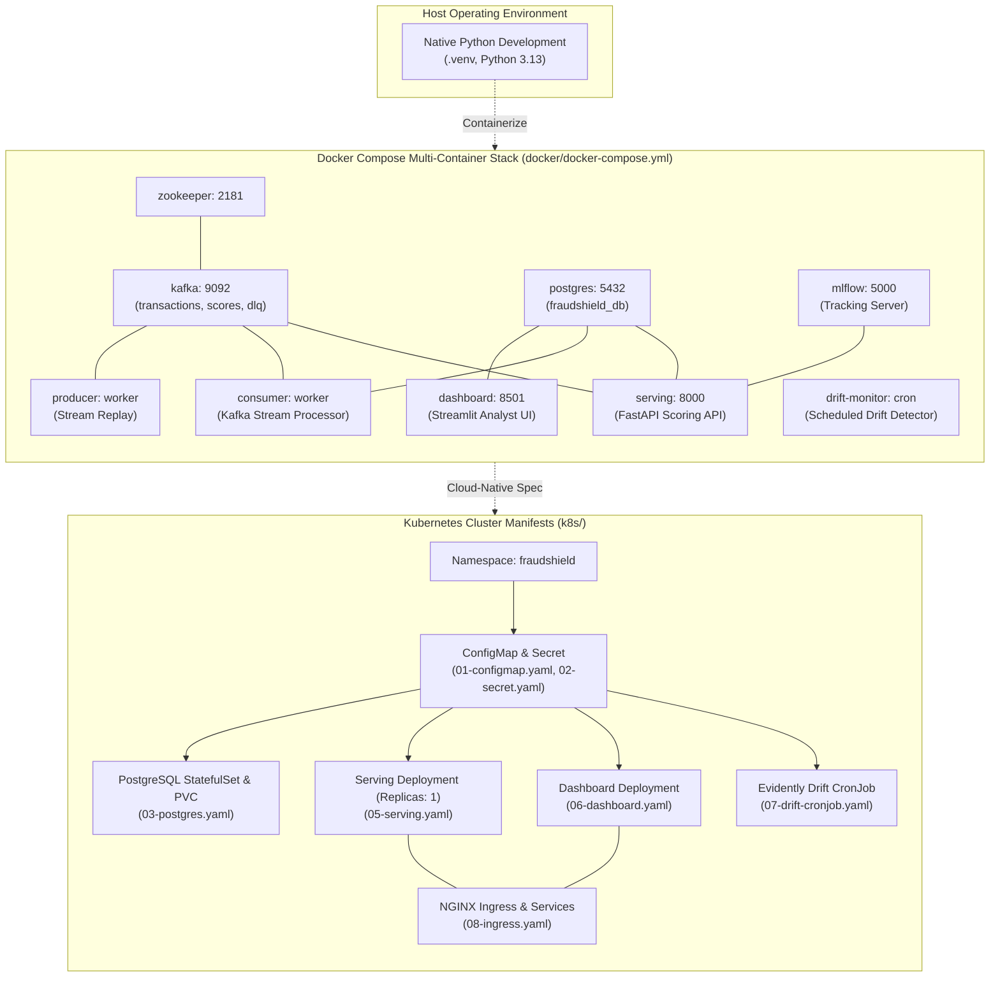

# FraudShield System Architecture

This document describes the architectural topology, data pipelines, scoring workflows, and deployment topology of **FraudShield**, an end-to-end real-time fraud detection and operations platform.

---

## 1. System Component Architecture

FraudShield integrates feature engineering, machine learning inference, real-time event streaming, operational relational persistence, human-in-the-loop analyst triage, and continuous drift monitoring into a unified ecosystem.

---

## 2. Request & Feedback Loop Flow

The scoring path decouples high-throughput, low-latency transaction evaluation from relational database persistence. Background worker queues guarantee sub-50ms execution while securing transactional audit trails.

---

## 3. Temporal Splitting & Leakage Isolation

To enforce strict production realism and prevent time-travel data snooping, FraudShield partitions the PaySim dataset strictly along chronological boundaries.

```mermaid
gantt
    title PaySim Chronological Data Partitioning Timeline (1 Step = 1 Hour)
    dateFormat X
    axisFormat Step %s
    
    section Training Window
    Train Set (Steps 1 to 323, 4.46M txns, 3,643 frauds) :active, train, 1, 323
    Graph Topology Construction (Steps 1 to 323)        :train_g, 1, 323
    Feast Offline Features Fit (Steps 1 to 323)          :train_f, 1, 323
    
    section Validation Window
    Validation Set (Steps 324 to 378, 980k txns, 564 frauds) :crit, val, 324, 378
    Hyperparameter Tuning & Threshold Sweep (t=0.99)         :val_t, 324, 378
    Control Drift Baseline Window                             :val_d, 324, 340
    
    section Hold-Out Test Window
    Frozen Evaluation Gate Set (15,000 txns, 115 frauds)     :gate, 379, 410
    Hold-Out Test Split (Steps 379 to 743, 918k txns, 4,006 frauds) :test, 379, 743
    Real-Time Replay & Smoke Verification                     :replay, 379, 743
```

### Architectural Guardrails Against Data Leakage
1. **Target Leakage Fields Dropped:** `newbalanceOrig` (drained to $0.00$ during fraud) and `newbalanceDest` are excluded prior to model input.
2. **Account Entity Separation:** Account identifiers (`nameOrig`, `nameDest`) are utilized solely as entity join keys for Feast feature store lookups and graph adjacency lookups, never passed directly to tree splitters.
3. **Out-of-Sample Preprocessing:** Scalers, category encoders, and mean-amount lookups are fitted strictly on steps $\le 323$ and applied out-of-sample to validation and test steps.
4. **Frozen Gate Set Isolation:** The automated retrain validation gate set is frozen in time from hold-out data. Candidate models must improve PR-AUC by $\ge +0.0010$ and preserve recall on this immutable slice before receiving traffic.

---

## 4. Deployment Topology (Docker Compose vs Kubernetes)

FraudShield provides dual deployment specifications engineered for operational flexibility:

### Deployment Scope & Verification Status
- **Docker Compose Stack:** Complete multi-service definition with healthchecks, persistent volumes, and inter-service dependencies.
- **Kubernetes Production Manifests:** Fully defined declarative specifications (StatefulSets, Deployments, ClusterIP Services, CronJobs, Ingress rules). `k8s/05-serving.yaml` is configured with `replicas: 1` to guarantee thread-safe SQLite online store access.
- **Host Execution Transparency:** Both Docker Compose and Kubernetes manifests are written and statically verified. Container daemons and Minikube virtual clusters were not provisioned on this host, preserving zero-dependency local Python reproducibility.

