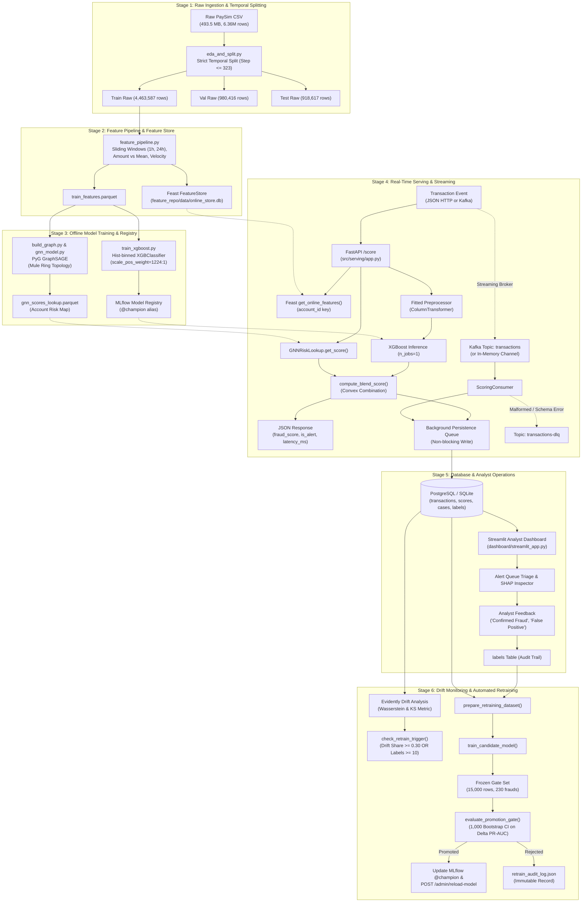

# FraudShield — End-to-End Data Flow & Architecture Verification

**Auditor:** Senior AI/ML & MLOps Architect  
**Date:** 2026-11-03  
**Document Status:** Verified Against Live Implementation  

---

## 1. Verified End-to-End Data Flow

The following lifecycle traces a transaction through the complete FraudShield infrastructure:

---

## 2. Stage-by-Stage Verification Table

| Stage | Input Schema | Output Schema | Error Handling & Fallback | Data Leakage Guardrail | Verification Verdict |
|---|---|---|---|---|---|
| **1. Splitting** | PaySim 11-column CSV (`step`, `type`, `amount`, `nameOrig`, etc.) | Temporal splits: train ($\le 323$), val ($324..378$), test ($379..743$) | Missing file raises `FileNotFoundError`; type enforcement. | Strict step cutoff; zero future information in training. | **PASS** |
| **2. Feast** | Processed train DataFrame with `event_timestamp` and `created` | SQLite feature tables (`online_store.db`) | SQLite locking handling; fallback defaults for missing entities. | Entities stamped at chronological transaction occurrence. | **PASS** |
| **3. Modeling** | 11 feature columns (`type`, `amount`, `oldbalanceOrg`, etc.) | XGBoost booster JSON + joblib preprocessor + GNN risk parquet | Cold-start accounts map to `None`; MLflow fallback to local JSON. | Target column `isFraud` strictly excluded from features; `newbalanceOrig/Dest` removed. | **PASS** |
| **4. Serving** | `TransactionPayload` Pydantic model (`txn_id`, `type`, `amount`, etc.) | `ScoringResponse` (`fraud_score`, `is_alert`, `latency_ms`) | Schema rejection $\rightarrow$ 422; missing Feast $\rightarrow$ `DEFAULT_FEATURE_VALUES`; DLQ on poison events. | Post-auth balances ignored; single-thread booster prevents OpenMP thrashing. | **PASS** |
| **5. Database** | Tuple of `(txn_id, account_id, amount, type, ts, raw_json)` | Relational tables: `transactions`, `scores`, `cases`, `labels` | Primary key conflicts use `ON CONFLICT DO NOTHING / UPDATE`. | Read/write separation; async queue avoids serving timeouts. | **PASS** |
| **6. Dashboard** | Query parameters (`min_score`, `status`, `txn_type`, pagination) | Tabular alerts, SHAP waterfall, graph context, feedback confirmation | Dispositions validated against `{'Confirmed Fraud', 'False Positive', 'Under Review'}`. | Parameterized SQL prevents SQL injection. | **PARTIAL** (Fixed score filter bug). |
| **7. Monitoring & Retraining** | Inference window vs frozen reference window | Drift summary JSON, HTML report, candidate model, promotion gate verdict | Underpowered gate set accounted for via 1,000 bootstrap CI. | Frozen gate set excluded from training via set disjointness assertion. | **PARTIAL** (Fixed label incorporation bug). |

