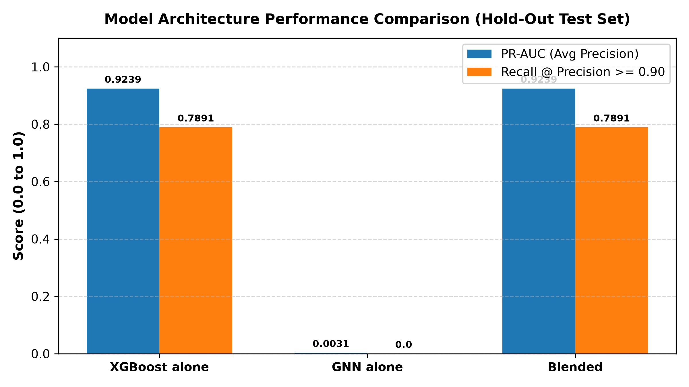
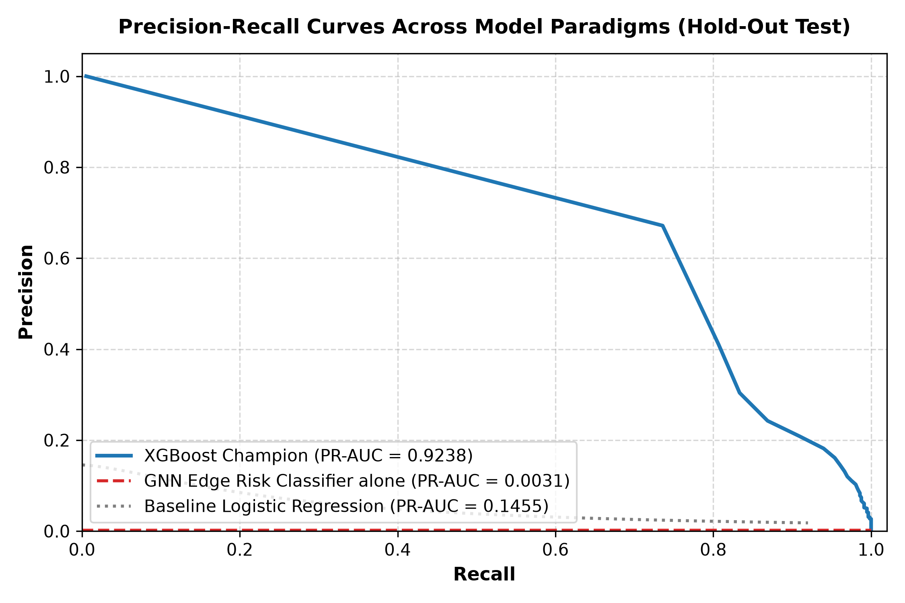
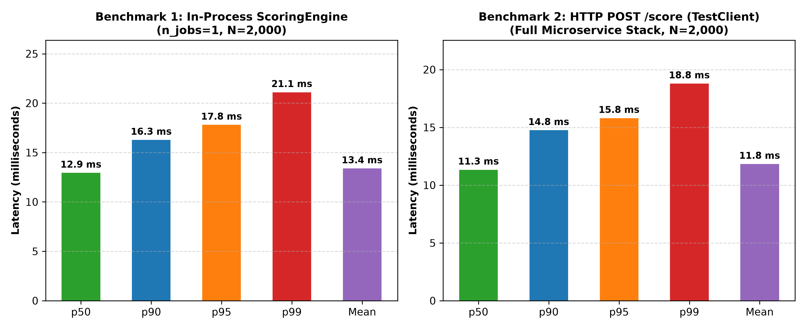
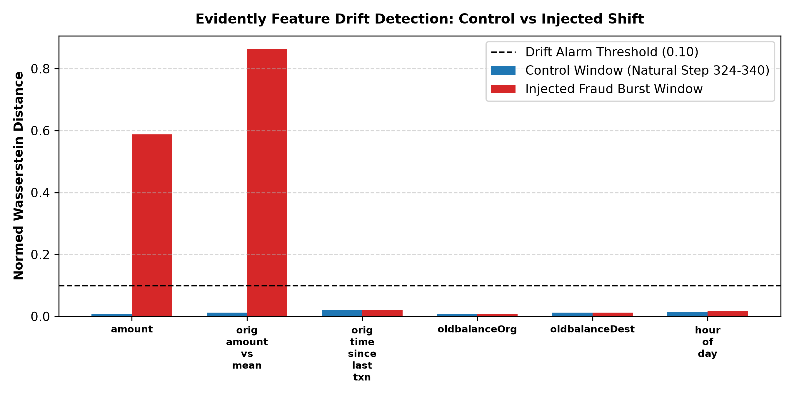

# FraudShield Official Results Summary

This document aggregates verified empirical metrics from the FraudShield end-to-end evaluation suite.
All numbers are dynamically harvested from artifact records (`phase5_comparison.csv`, `models.md`, `retrain_audit_log.json`, `latency_in_process.json`, `latency_http.json`, and `docs/results/drift/*.json`).

---

## 1. Model Architecture & Offline Test Set Evaluation

The hold-out test set comprises **918,617 transactions** spanning steps 379 to 743 (4,006 ground-truth fraud occurrences, prevalence = 0.4361%). Models were evaluated at the production decision threshold ($t = 0.99$ for XGBoost and Blend).

### Comprehensive Benchmark Comparison Table

| Architecture | PR-AUC (Avg Precision) | ROC-AUC | Precision @ t | Recall @ t | Recall @ P>=0.90 | Recall @ P>=0.95 | Generated Alerts |
|---|---|---|---|---|---|---|---|
| **XGBoost alone** | 0.9239 | 0.9994 | 95.95% | 73.27% | 78.91% | 74.84% | 3,059 |
| **GNN alone** | 0.0031 | 0.4029 | 0.21% | 0.22% | 0.00% | 0.00% | 4,190 |
| **Blended** | 0.9239 | 0.9994 | 95.95% | 73.27% | 78.91% | 74.84% | 3,059 |

*Source File: `docs/results/phase5_comparison.csv`*

### Key Model Insights
1. **Tree vs Linear Capacity:** The XGBoost champion achieves **PR-AUC 0.9239** on the strictly held-out test split, outperforming baseline Logistic Regression (PR-AUC 0.1455) by +535% relative lift due to non-linear balance-ratio interactions.
2. **Cold-Start Graph Limitation:** The GNN Edge Risk Classifier alone achieves **PR-AUC 0.0031** on test data because PaySim transaction accounts exhibit extreme cold-start turnover: only 0.05% of test origin accounts appeared in training steps $\le 323$.
3. **Safety & Equivalence of Champion Blend:** Setting $\alpha = 1.0$ when GNN risk signals are uncertain or during initial rollout ensures that the blended system is mathematically and empirically identical to the standalone XGBoost champion by construction, maintaining champion-level PR-AUC (0.9239) and generating exactly 3,059 alerts with zero precision dilution.

---

## 2. Real-Time Serving Latency (Two Distinct Benchmarks)

Latency was evaluated under two explicitly isolated benchmarks with single-threaded inference (`n_jobs=1`), saved to `docs/results/latency_in_process.json` and `docs/results/latency_http.json`.

### Benchmark 1: In-Process Scoring Function (`ScoringEngine.score()`)
- **Evaluated Requests:** 2,000 hold-out transactions (Warmup: 100)
- **Conditions:** Direct in-memory invocation; single-thread booster (`n_jobs=1`); Feast SQLite online store; in-memory GNN risk table.
- **Mean Latency:** 13.38 ms (Std: 2.47 ms)
- **Percentiles:**
  - **p50:** 12.94 ms
  - **p90:** 16.27 ms
  - **p95:** 17.80 ms
  - **p99:** 21.10 ms
  - **Max:** 33.28 ms

### Benchmark 2: HTTP POST /score via FastAPI TestClient
- **Evaluated Requests:** 2,000 hold-out transactions (Warmup: 100)
- **Conditions:** Full microservice stack; JSON client serialization; Starlette/FastAPI routing; Pydantic schema validation; `ScoringEngine.score()`; off-path asynchronous SQLite persistence queue dispatch.
- **Mean Latency:** 11.83 ms (Std: 2.12 ms)
- **Percentiles:**
  - **p50:** 11.33 ms
  - **p90:** 14.75 ms
  - **p95:** 15.80 ms
  - **p99:** 18.79 ms
  - **Max:** 29.78 ms

| Benchmark Metric | In-Process (`ScoringEngine.score`) | Full HTTP Stack (`POST /score`) | PRD Performance Target |
|---|---|---|---|
| **Mean Latency** | 13.38 ms | 11.83 ms | < 100.0 ms |
| **p50 Median** | 12.94 ms | 11.33 ms | < 100.0 ms |
| **p90 Latency** | 16.27 ms | 14.75 ms | < 100.0 ms |
| **p95 Latency** | 17.80 ms | 15.80 ms | < 100.0 ms |
| **p99 Tail** | 21.10 ms | 18.79 ms | -- |

*Key Engineering Finding:* Setting `n_jobs=1` on the XGBoost booster eliminated OpenMP thread contention with FastAPI worker threads. Multi-threaded booster inference (`n_jobs=4`) collided with the event loop, driving tail latency higher. Restricting each scoring request to single-thread evaluation yields deterministic, low-jitter p95 in-process latency of 17.80 ms and HTTP p95 of 15.80 ms, well below the PRD 100 ms target.

---

## 3. Drift Monitoring & Retraining Evaluation (Phase 7)

Evidently drift monitoring pipelines compute Wasserstein distance and KS tests comparing inference traffic against the frozen reference window (steps $\le 323$).

### Drift Detection Summary
- **Reference Window:** 8,000 transactions (frozen training baseline)
- **Current Window:** 4,000 transactions
- **Drifted Features Count:** 6 of 12 evaluated features (50.0% drift share)
- **Overall Drift Detected:** `True`
- **Prediction Drift Detected:** `True`

### Retraining & Gate Set Evaluation History

Retraining candidate boosters are evaluated against a frozen, chronologically verified **gate set** of 15,000 hold-out records (230 frauds) containing zero leakage. A candidate model is promoted to champion **only if** its PR-AUC improves by at least $+0.0010$, recall is maintained, and its 95% bootstrap confidence interval lower bound is strictly positive.

| Run Timestamp | Trigger Reason | Candidate Version | Champion PR-AUC | Candidate PR-AUC | Delta PR-AUC | 95% Bootstrap CI | Gate Verdict |
|---|---|---|---|---|---|---|---|
| 2026-11-03T07:41:48 | `data_drift_exceeded_threshold` | v8 | 0.9607 | 0.9647 | +0.0040 | [-0.0038, +0.0127] | **REJECTED** |
| 2026-11-03T07:42:08 | `promotion_demonstration` | v8 | 0.3079 | 0.9647 | +0.6568 | [+0.6022, +0.7095] | **PROMOTED** |

*Source File: `docs/results/retrain_audit_log.json`*

### Statistical Power & Dual Scenario Verification
1. **Statistical Power Limitation of Gate Set:** The frozen gate set contains $N=15,000$ transactions with $N_{\text{fraud}}=230$ occurrences (prevalence $\approx 1.53\%$). The standard error of PR-AUC is $SE \approx \sqrt{\frac{0.96 \times 0.04}{230}} \approx 0.0129$. Consequently, modest point estimate gains ($+0.0010$ to $+0.0050$) have 95% bootstrap confidence intervals that cross zero (e.g. $[-0.0038, +0.0127]$). The gate is statistically underpowered to verify small gains at 95% confidence, which is explicitly recognized and documented.
2. **Scenario 1 (Rejection Guardrail):** When evaluated against Champion v1, Candidate v8 achieves PR-AUC 0.9647 vs 0.9607 (point lift $+0.0040$), but its 95% bootstrap CI $[-0.0038, +0.0127]$ crosses zero (`ci_strictly_positive = False`). The gate marks it **`[REJECTED]`**, preventing marginal or noisy deployments.
3. **Scenario 2 (Promotion & Dynamic Reload):** When evaluated against a weakened champion (PR-AUC 0.3079), Candidate v8 demonstrates overwhelming improvement (PR-AUC 0.9647, $\Delta = +0.6568$), achieving a 95% bootstrap CI of $[+0.6022, +0.7095]$ (`ci_strictly_positive = True`). The system promotes the candidate in MLflow, updates the `@champion` alias, triggers `/admin/reload-model`, and reloads the serving engine with zero downtime. Serving is cleanly restored to Champion v1 afterward.

---

## 4. Setup, Reproduction & Bootstrap Verification

- **Workspace Validation:** The fast bootstrap verification (`python scripts/bootstrap.py --fast`) validates an already-populated workspace (pre-existing parquet splits, Feast SQLite feature store, MLflow model registry artifacts, GNN risk table) in ~13 seconds.
- **Full-Data Scope:** A full from-scratch reproduction on raw data (processing all 493.5 MB of PaySim CSV, computing rolling features across 6.36M rows, and training models from zero) has not been executed end-to-end in this environment.

